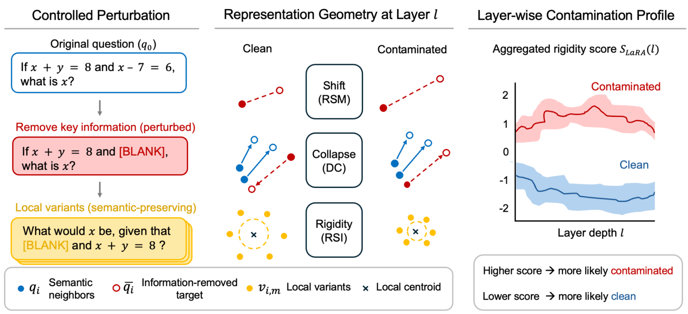
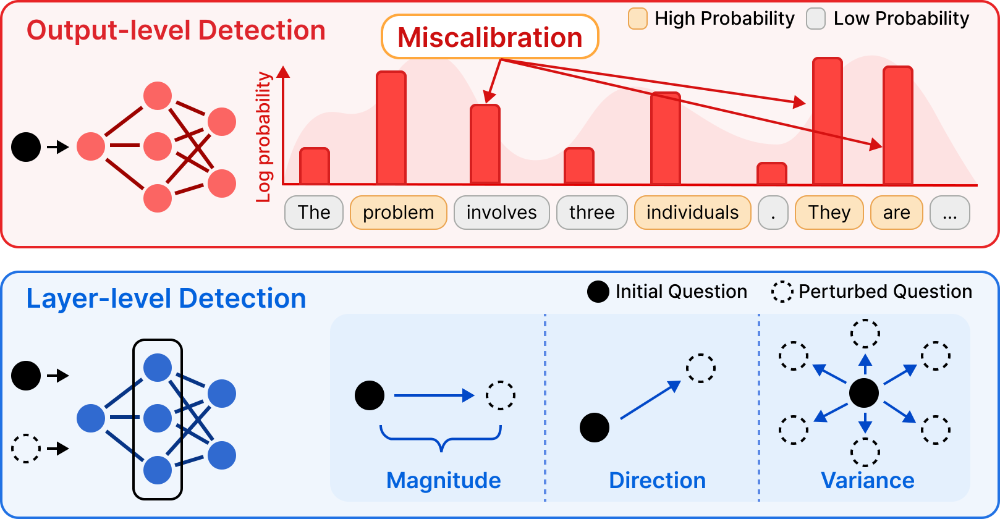

# LaRA: Layer-wise Representation Analysis for Detecting Data Contamination in RL Post-Training

Official implementation · **EMNLP 2026 Findings**

[Paper (arXiv)](https://arxiv.org/abs/2605.29888) · [Project page](https://talzoomanzoo.github.io/lara-project-page/) · [Model collection](https://huggingface.co/collections/talzoomanzoo/lara-contamination)

Implementation was based on the original code from [RL-Data-Contamination](https://github.com/yongding-tao/RL-Data-Contamination).

LaRA analyzes a model's internal representations across layers to detect data contamination after reinforcement learning (RL) post-training. This repository provides the LaRA detector, baseline detectors, evaluation scripts, and code for training contaminated models.



**Method overview.** LaRA removes key information from a question and creates variants that preserve its meaning. It measures representation shift, directional collapse, and local rigidity across layers, combining these signals into a contamination score. Higher scores indicate stronger evidence of contamination.



**Why look inside the model?** Miscalibrated output probabilities can make contamination difficult to detect. LaRA examines how internal representations respond to perturbed questions, capturing changes in magnitude, direction, and variance across layers.

---

## 1. Set up the environment

Requires Linux, NVIDIA GPUs, and CUDA compatible with PyTorch and FlashAttention. Run all commands from the repository root.

```bash
conda create -n rl-contamination python=3.10 -y
conda activate rl-contamination

pip install -r RL_Contaminate/verl/verl/requirements.txt
pip install --no-build-isolation -e RL_Contaminate/verl
pip install -e RL_Contaminate/verl/verl
pip install scikit-learn tqdm requests python-dotenv hf_transfer

export PYTHONPATH="$PWD/RL_Contaminate/verl:$PWD/RL_Contaminate/verl/verl:${PYTHONPATH:-}"
export PYTHON="$(command -v python)"
```

LaRA and Self-Critique + LaRA require an OpenRouter API key:

```bash
export OPENROUTER_API_KEY="your-openrouter-api-key"
```

## 2. Train a model

Prepare training and validation Parquet files, then review the model and GPU settings in the selected [training script](RL_Contaminate/train_scripts/).

To train EURUS on four GPUs:

```bash
export TRAIN_FILE="/absolute/path/to/train.parquet"
export VAL_FILE="/absolute/path/to/validation.parquet"
export WANDB_MODE=offline

CUDA_VISIBLE_DEVICES=0,1,2,3 bash RL_Contaminate/train_scripts/eurus_grpo.sh
```

## 3. Evaluate a model

```bash
# Evaluate LaRA on EURUS KK epoch 0.
CUDA_VISIBLE_DEVICES=0 bash eval_scripts/KK/run_eurus_grpo_kk_mia_epoch_0.sh \
    --detectors lara

# Evaluate selected detectors across EURUS KK checkpoints.
bash eval_scripts/run_collection.sh \
    --family eurus --task kk --detectors lara ppl mink

# Evaluate all published checkpoints with all detectors.
bash eval_scripts/run_collection.sh
```